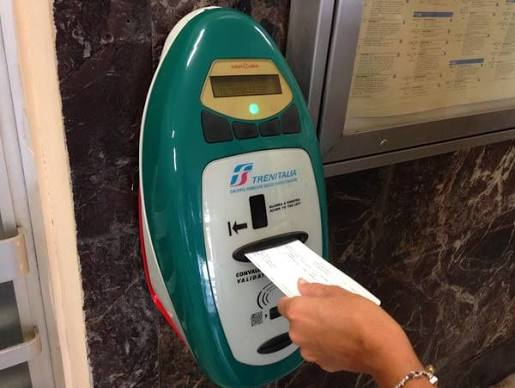
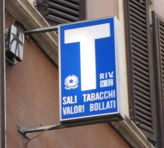

# Общественный транспорт в Италии

Краткое содержание:  
[🚆 ЖД](#rail) · [🚌 Автобус](#bus) · [🚊 В городе](#city) · [⛴️ Паром](#ferry)

## 🚆 Железная дорога {/* #rail */}

### Виды поездов

- **🟢 FS (Servizio Ferroviario)** - пригородная электричка, обычно со всеми остановками.
- **🟢 R/RE (Regionale)** - региональный поезд, пропускающий небольшие остановки.
- **🟢 RV (Regionale Veloce)** - региональный экспресс, пропускает небольшие и средние станции.
- **🔵 IC (InterCity)** - междугородний экспресс, остановки только на крупных станциях.
- **🔴 FR (Frecciarossa)** - скоростной поезд от Trenitalia.
- **🔴 Italo** - частный скоростной поезд, билеты и расписание только на собственном сайте или агрегаторах.

### Бронирование места

В каждом билете **Frecciarossa** и **Italo** указано конкретное место. Его можно выбрать при покупке (платно), либо оно будет назначено автоматически. В **региональных поездах** и **InterCity** места не назначаются, можно занять любое свободное.

### Расписание и билеты

- 🟢 [**Trainline ↗**](https://www.thetrainline.com/) - агрегатор: можно купить билеты Trenitalia, Italo и междугородние атвобусы
- 🟠 [**Trenìt ↗**](https://trenit.app/) - актуальное расписание поездов, включая текущие опоздания.
- 🟡 [**Interrail ↗**](https://www.interrail.com/en) - международный абонемент на поезда Европы и Турции. Полезен при дальних поездках по нескольким странам.

:::info Валидация билетов
Если вы купили билет в приложении, то валидация не нужна. Но если у вас **бумажный билет** на поезд без зарезервированного места (**региональный** или **InterCity**), то его нужно обязательно прокомпостировать перед поездкой. ***В вагонах валидаторов нет***, они располагаются на платформах, в переходах или на станции.

Вставляя билет в компостер, сместите его ***максимально влево***, как показано на фото.
:::

  
<small>Валидация ж/д билета</small>

Как меняется цена билетов:
- **Региональные и пригородные поезда** - фиксированная цена, можно покупать хоть за полчаса до выезда.
- **InterCity, Frecciarossa, Italo** - цена стремительно растет по мере приближения даты поездки, покупайте заранее.

## 🚌 Междугородние автобусы {/* #bus */}

### Расписание и билеты

- 🟣 [**Omio ↗**](https://www.omio.com/) - агрегатор билетов на автобус, есть и ж/д билеты.
- 💰 Иногда можно купить билет в салоне за наличные, иногда только через терминал, иногда только в табачном киоске (Tabaccheria, о ней ниже). Поэтому предпочтительно покупать онлайн.

## 🚊 Городской транспорт {/* #city */}

### Как построить маршрут

:::info Опоздания
Расписание и информация об опозданиях во всех приложениях ***очень условные***, часто автобусы ходят по своему собственному расписанию, особенно в больших городах с интенсивным трафиком.
:::

- [🔵 **Google Maps ↗**](https://www.google.com/maps) - поддерживает маршруты в большинстве городов.
- [🟢 **Citymapper ↗**](https://citymapper.com/) - хорошо строит маршруты в крупных городах.
- [🟠 **Moovit ↗**](https://moovitapp.com/) - большое количество региональных маршрутов (много рекламы).

### Где купить билет

В каждом регионе работает собственная компания городского транспорта, со своими билетами и тарифами.

- 💶 **За наличные**  
Зайдите в табачный киоск (Tabaccheria). В небольших городах билет можно купить и в барах: они часто совмещают функции табачных лавок.

- 💳 **Картой в автобусе**  
В большинстве автобусов и трамваев установлены терминалы оплаты, можно купить билет прямо в салоне, приложив карту или телефон к считывателю.  
<small>⚠️ Иногда не срабатывают карты, выпущенные вне ЕС.</small>

- 📱 **В приложении**  
Если считывателя в салоне нет, или он старый (такое иногда бывает в Турине), то можно купить билет в приложении. ***Не забудьте активировать билет после покупки.***  
<small>⚠️ Иногда не срабатывают карты, выпущенные вне ЕС.</small>

  
<small>Вывеска табачного киоска в Италии</small>

### Пополнение транспортных карт
Проездные картонные карты, похожие на кредитку, можно пополнить в терминалах на вокзалах, или онлайн:  
- Генуя: [AMT ↗](https://www.amt.genova.it/amt/biglietti-e-abbonamenti-2/)
- Милан: [ATM ↗](https://www.atm.it/en/viaggiaconnoi/biglietti/pages/doveacquistare.aspx)
- Рим: [ATAC ↗](https://www.atac.roma.it/en/tickets-and-passes/request-and-charge-online)
- Турин: [GTT ↗](https://ecommerce.gtt.to.it/public-home)

### Контроль билетов

**Случается нередко.** Если вы оплатили картой через терминал в салоне автобуса/трамвая, контроллеры попросят вас открыть приложение банка и показать списание, однако часто происходит лишь авторизация, и по итогу дня система списывает либо цену разового билета, либо дневного (если две и более поездки), поэтому после оплаты в приложении отображается не покупка, а лишь блокировка средств. Если в приложении транзакция не отображается вовсе, просто назовите вашу фамилию, по ней контроллер найдет платеж в системе.

### Абонемент на общественный транспорт

Можно купить в офисе транспортной компании, которая как правило находится рядом с железнодорожным или авто- вокзалом. При покупке вас попросят показать оригинал или скан/фото сертификата [Codice Fiscale](../business/codice-fiscale.mdx).

## ⛴️ Паромы {/* #ferry */}

🟨 TODO

