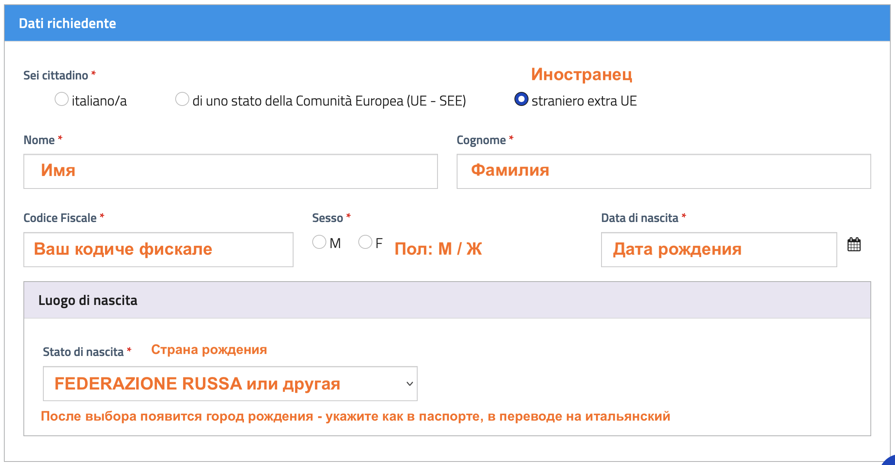
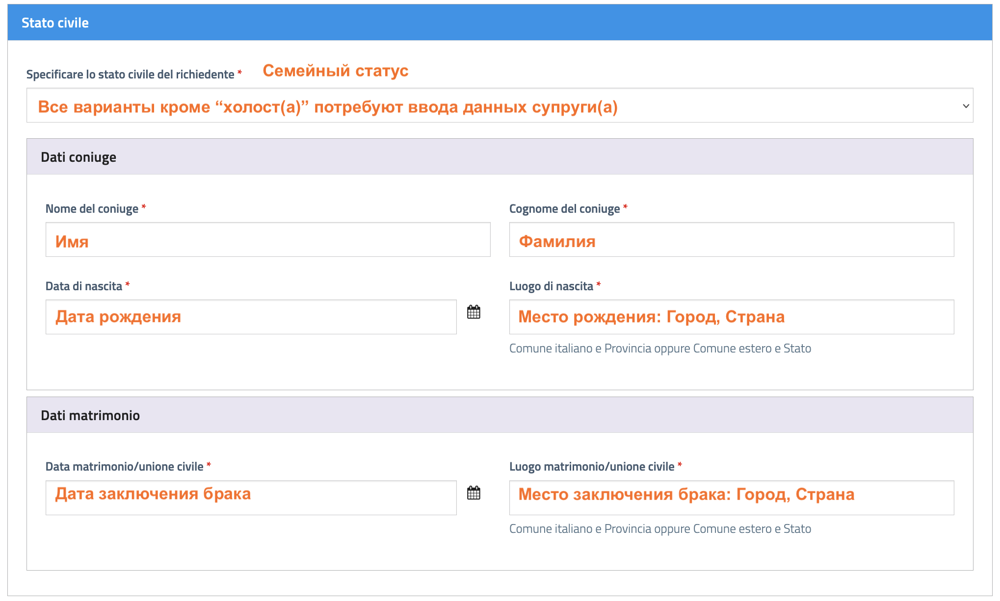
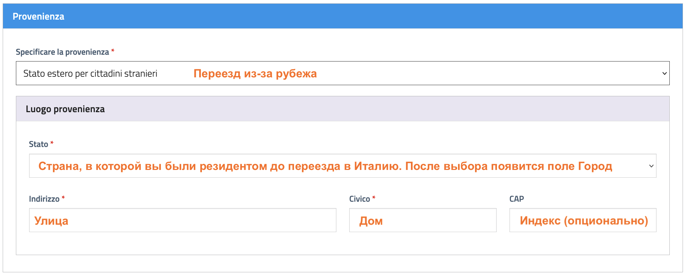
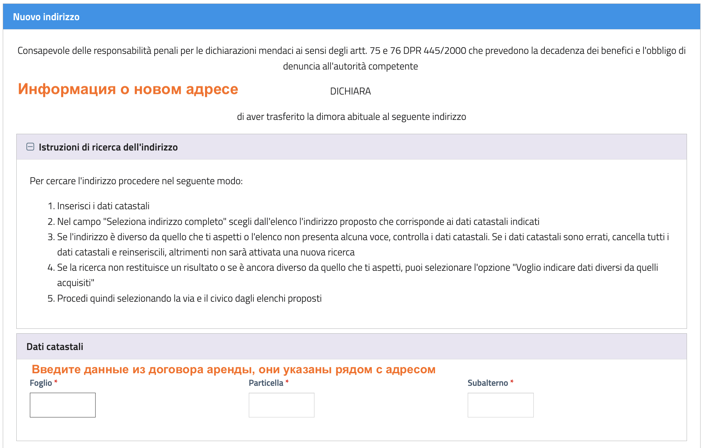
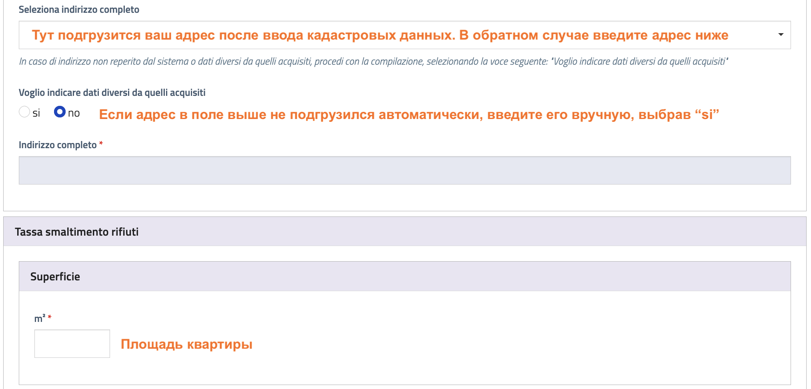
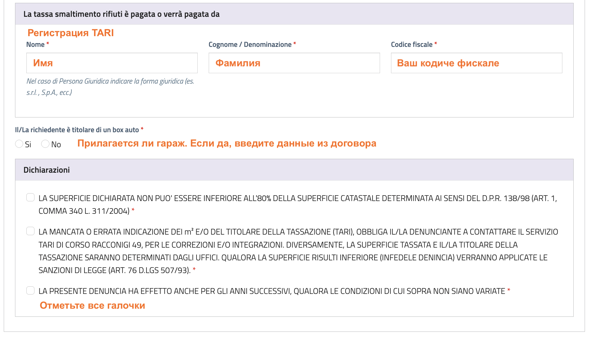
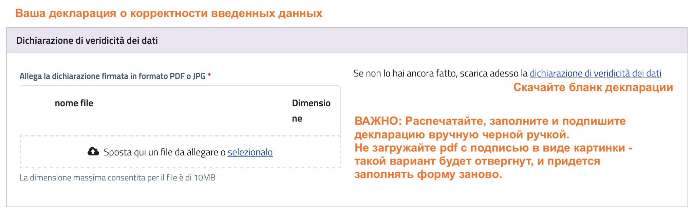
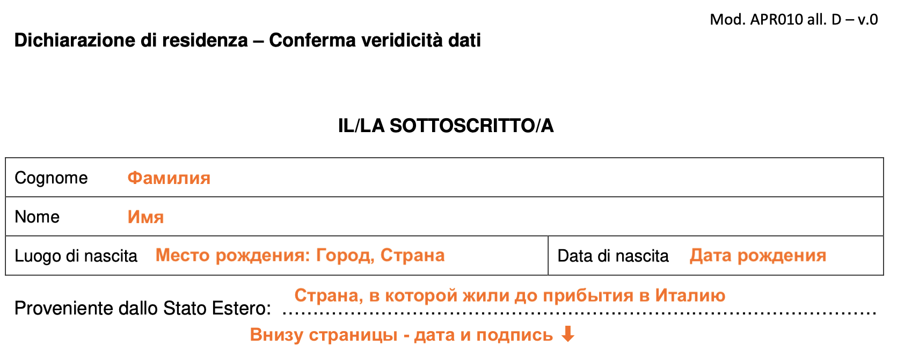
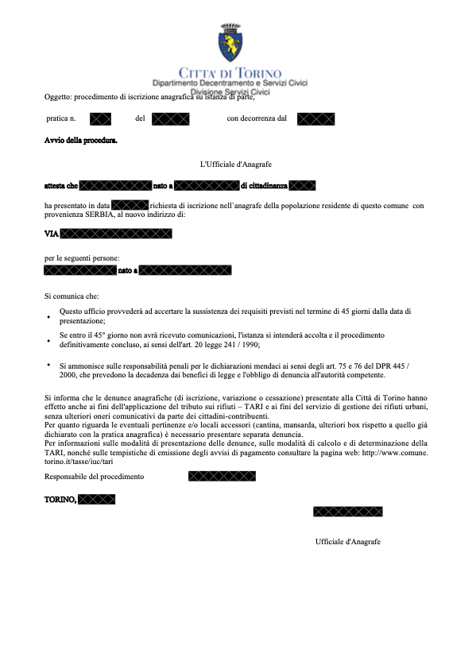

# Регистрация по месту жительства (прописка) в Италии

:::note INFO
По прибытию в Италию, в течение 20 дней нужно отправить заявку на регистрацию в коммуне.

После отправки заявления, у коммуны есть 45 дней, чтобы отправить к вам полицейского, который проверит, что вы живете по данному адресу. В течение этого времени постарайтесь не уезжать из города на буднях. Познакомьтесь с соседями, чтобы они смогли сообщить о вашем проживании, если вас не будет дома.
* Часто визит происходит рано утром, чтобы проверить, что вы ночуете по этому адресу.
* В небольших городах проверка может быть произведена несколько раз.
* Иногда полиция может ограничиться звонком на мобильный телефон.
* Если по прошествии 45 дней никто не пришел с проверкой, то вы автоматически зарегистрированы.

🗑️ **При регистрации обратите внимание на TARI**

TARI - налог на вывоз мусора. В некоторых коммунах, например, в Турине и Генуе, вам подключат TARI автоматически при регистрации. В большинстве других случаев нужно регистрировать TARI отдельно.

Если в процессе подачи заявки на прописку у вас попросят кадастровые данные квартиры (площадь, foglio, particella и др.) для регистрации **Tassa sui Rifiuti (TARI)** то налог на мусор будет добавлен автоматически. При личной подаче обязательно уточните это у оператора: ***"TARI sarà registrato automaticamente?"***

[Подробнее о TARI →](../realty/tari)
:::

**Пакет документов:**
* Паспорт
* Личная ID карта [CIE](cie) (если есть)
* Карточка ВНЖ или [Ричевута](ricevuta)
* Договор аренды

**Прежде, чем начать**. Найдите сайт вашей коммуны, загуглив "**comune [ваш город]**". Популярные коммуны:
* Генуя: https://comune.genova.it/
* Милан: https://comune.milano.it/
* Рим: https://comune.roma.it/
* Турин: https://comune.torino.it/

Отправить заявление на регистрацию по месту жительства можно двумя способами: 
1. [🏛️ Лично, в центральном Anagrafe коммуны](#cf-v1)
2. [📍 Лично, в местном Anagrafe](#cf-v2)
3. [🌐 Онлайн](#cf-v3)
---

## 🏛️ Способ 1. Лично, в центральном отделении Anagrafe. {/* #cf-v1 */}

:::warning Не ходите в CAF
CAF (Centro di Assistenza Fiscale) - аналог сервисных центров "Мои документы". ИИ ошибочно отправляют регистрироваться там - не тратьте время.
* Не все CAF делают регистрацию (надо обзванивать и спрашивать).
* CAF может вас зарегистрировать, только если у вас есть электронная подпись, которую можно получить ***после*** отправки заявки на регистрацию.
:::

1. Зайдите на сайт вашей коммуны, в раздел **Servizi → Anagrafe → Cambio di Residenza**. Если в этом разделе есть опция "Запись на прием" (**Prenota appuntamento**), попробуйте записаться онлайн.

2. Выберите офис **Anagrafe Centrale per non residenti**.

3. Часто бывает, что доступных слотов для записи нет. В этом случае идите в центральный офис Anagrafe без записи. Адрес можно найти на Гугл картах, набрав "**Anagrafe centrale [ваш город]**". Лучше приезжать утром, т.к. прием документов заканчивается в районе полудня, а очередь может быть внушительной.

**Скажите:** *Vorrei fare il cambio di residenza* (Я хотел бы сделать прописку)\
**У вас спросят:** *Ha un appuntmento?* (Вы записаны?)\
**Вы:** *No*\
**Они:** *Deve andare li...* (Покажут куда идти)

Регистрирация без записи обычно производится через отдельный вход.

---

## 📍 Способ 2. Лично, в местном Anagrafe. {/* #cf-v2 */}
Наберите в Гугл-картах ***[ваш индекс] Anagrafe***. Найдите адрес вашего местного центра и прийдите туда утром. В некоторых центрах есть возможность получить запись на регистрацию. 

**Скажите:** *Vorrei fare un appuntamento per il cambio di residenza* (Я хотел бы сделать запись на регистрацию)

Если отправят в цетральный офис - переходим к [Способу 1 ↑](#cf-v1).

---

## 🌐 Способ 3. Онлайн на сайте коммуны. {/* #cf-v3 */}

:::info Данный способ доступен не во всех городах
:::

1. Зайдите на сайт коммуны, в раздел **Servizi → Anagrafe** 
    
    Найдите услугу **Cambio di residenza**. Если их несколько, выберите вариант "прибытие из-за рубежа" (**dall'estero**).
    
    * **Милан**\
    Перед началом заполнения формы зарегистрируйтесь на портале.\
    [Richiesta di residenza per persone straniere provenienti dall’estero ↗](https://formshd4.comune.milano.it/rwe2/module_preview.jsp?MODULE_TAG=MOD_DDR_ESTERO) 
        
    * **Турин**\
    ***Не*** нажимайте кнопку **Accedi** (она ведет на вход с цифровой подписью). Нажмите в тексте рядом ссылку **"servizio di compilazione guidata"**.\
    [Richiedere il cambio residenza da un altro comune, dall'estero o a seguito di cancellazione per irreperibilità ↗](https://www.comune.torino.it/servizi/richiedere-cambio-residenza-un-altro-comune-dallestero-seguito-cancellazione-per) 

    * **Рим, Генуя**\
    Cервис доступен только с цифровой подписью → переходим к [Способу 1 ↑](#cf-v1)

2. Заполнение анкеты онлайн

    В зависимости от коммуны, формы могут отличаться, но по структуре будут близки. Поскольку в Турине форма включает в себя TARI, приведем ее как наиболее развернутый пример.

### Форма онлайн-заявления

1. **Информация для ознакомления.**

2. **Защита данных.** Поставьте галочку, что вы согласны с политкой защиты данных.

3. **Заявитель.** Укажите ваши личные данные, загрузите копию ***ВНЖ/ричевуты*** и ***паспорта*** (лицевая сторона + виза со штампом о въезде в Италию, если первый запрос).
    
    
    <small>Заполнение данных заявителя</small>

    
    <small>Заполнение семейного статуса</small>

4. **Гражданство.**

5. **Профессия.** Выберите из списка ваше образование и профессию.

6. **Автомобили.** Если у вас есть авто, добавьте информацию о нем.

7. **Семья.** Только те члены семьи, что въезжают на новое жилье вместе с вами.

8. **Адрес предыдущей прописки.** Укажите где вы жили до въезда в Италию. Это не связано с гражданством: если у вас российский паспорт, но до переезда в Италию жили в Армении, то укажите адрес в Армении.

    
    <small>Заполнение предыдущего адреса прописки</small>

9. **Новый адрес прописки.** Адрес из договора аренды.

10. **Параметры жилья.** Кадастровые данные из договора аренды.

    
    <small>Заполнение кадастровых данных нового жилья</small>

    
    <small>Добавление адреса нового жилья</small>

    
    <small>Регистрация TARI</small>

11. **Контакты.** Внимательно проверьте корректность email адреса и телефона - на них будут приходить информация и звонки, связанные с регистрацией.

12. **Декларация корректности.** Скачайте бланк декларации, распечатайте, заполните и подпишите черной ручкой, загрузите фото/скан документа. ***Важно:*** Не загружайте pdf с подписью в виде картинки - такой вариант будет отвергнут, и придется заполнять форму заново.
    
    
    <small>Загрузка декларации</small>

    
    <small>Заполнение декларации</small>

13. **Приложения.** Загрузите копию ***кодиче фискале***, ***договора аренды*** и ***CIE***.

14. **Уведомление.** Форма заполнена.

15. **Обзор.** Еще раз проверьте все введенные данные. Скачайте загруженные документы, чтобы убедиться, что они подгрузились корректно.

16. **Отправка.** Finito! Скачайте pdf с информацией, которую вы отправили.

:::info ВАЖНО
Сразу после отправки формы к вам на указанный email придет pdf с данными отправленной формы. **Это не подтверждение начала процесса регистрации,** а лишь подтверждение **отправки** документов.
Примерно через 2 рабочих дня вы получите информацию о том, была ли заявка ***принята***, или ***отвергнута*** (в этом случае нужно отправить заявление заново). 

Подтверждение об успешном приеме документов выглядит так:

<small>Подтверждение начала процедуры регистрации</small>

Если документы не приняли, а время поджимает, переходим к [Способу 1 ↑](#cf-v1).
:::

