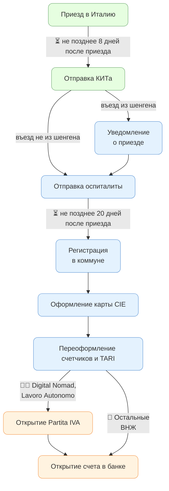

# План действий по прибытии в Италию

:::info INFO
Что сделать ДО прибытия в Италию:
- Записаться на [оформление карты CIE](./cie) (1-2 месяца)
- Записаться в бесплатную школу итальянского CPIA (1-2 недели)
- Обсудить с бухгалтером форму будущего [Partita IVA](../business/partita-iva) (2 недели)
:::

